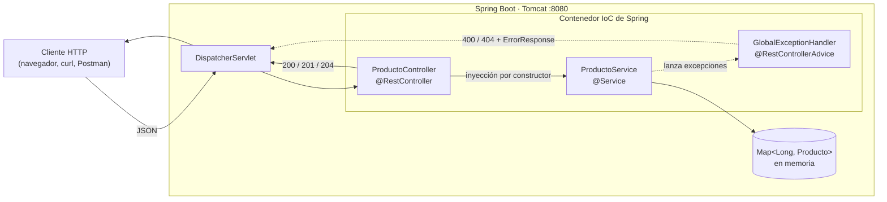
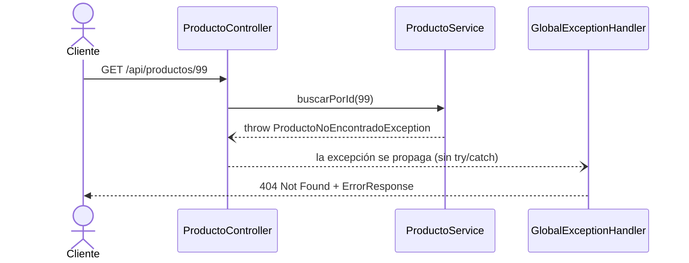

# Desarrollo de una API REST con inyección de dependencias y manejo de excepciones

**Taller individual 1.1** · Programación Avanzada (NRC 36759) · Universidad de las Fuerzas Armadas ESPE
**Autor:** Romario Javier Alban Moreta

API REST para la gestión básica de los productos de una tienda, construida con **Spring Boot 4.1.2** y **Spring Web**.
Los productos se almacenan temporalmente en una colección en memoria, sin base de datos. El objetivo de la práctica es
aplicar **Inversión de Control (IoC)**, **inyección de dependencias por constructor** y **manejo centralizado de
excepciones**, manteniendo una separación clara de responsabilidades entre las clases.

---

## Tabla de contenido

1. [Objetivos](#objetivos)
2. [Tecnologías](#tecnologías)
3. [Arquitectura](#arquitectura)
4. [Estructura del proyecto](#estructura-del-proyecto)
5. [Modelo de datos](#modelo-de-datos)
6. [Reglas de negocio](#reglas-de-negocio)
7. [Endpoints](#endpoints)
8. [Manejo de errores](#manejo-de-errores)
9. [Inyección de dependencias](#inyección-de-dependencias)
10. [Cómo ejecutar](#cómo-ejecutar)
11. [Pruebas](#pruebas)
12. [Decisiones de diseño](#decisiones-de-diseño)

---

## Objetivos

- Crear un proyecto Spring Boot con Spring Initializr usando únicamente la dependencia **Spring Web**.
- Organizar la aplicación en capas: **modelo**, **servicio** (reglas de negocio) y **controlador** (HTTP).
- Hacer que el servicio sea un bean administrado por Spring e inyectarlo en el controlador **por constructor**, sin usar `new`.
- Lanzar excepciones personalizadas ante datos inválidos o recursos inexistentes y resolverlas en un único
  componente con `@RestControllerAdvice`.
- Responder con códigos HTTP coherentes: `200`, `201`, `204`, `400` y `404`.

## Tecnologías

| Herramienta | Versión | Uso |
|---|---|---|
| Java (Eclipse Temurin) | 21 | Lenguaje y JDK |
| Spring Boot | 4.1.2 | Framework de la aplicación |
| Spring Web (`spring-boot-starter-webmvc`) | 4.1.2 | Spring MVC, Jackson (JSON) y Tomcat embebido |
| Maven + Maven Wrapper | 3.9 | Gestión de dependencias y construcción |
| JUnit 5 + MockMvc (`spring-boot-starter-webmvc-test`) | — | Pruebas automatizadas de los endpoints |
| IntelliJ IDEA | 2026.3 | Desarrollo, ejecución y pruebas |

## Arquitectura

La aplicación sigue una arquitectura en capas. Spring crea los beans (`ProductoController`, `ProductoService`,
`GlobalExceptionHandler`) y conecta sus dependencias; ninguna clase crea a otra manualmente.



| Capa | Clase | Responsabilidad |
|---|---|---|
| Modelo | `Producto` | Representar los datos de un producto |
| Servicio | `ProductoService` | Almacenar los productos en memoria y aplicar las reglas de negocio |
| Controlador | `ProductoController` | Recibir solicitudes HTTP, delegar en el servicio y fijar el código de estado |
| Excepciones | `ProductoNoEncontradoException`, `ProductoInvalidoException` | Señalar un id inexistente o datos inválidos |
| Excepciones | `ErrorResponse` | Estructura JSON común de todos los errores |
| Excepciones | `GlobalExceptionHandler` | Convertir cada excepción en una respuesta HTTP |

### Flujo de una solicitud con error



## Estructura del proyecto

```
api-productos/
├── pom.xml                                   Dependencias: Spring Web y starter de pruebas
├── mvnw, mvnw.cmd, .mvn/                     Maven Wrapper (no requiere Maven instalado)
├── requests/
│   ├── api-productos.http                    Las 8 solicitudes de prueba (cliente HTTP de IntelliJ)
│   ├── producto-valido.json
│   ├── producto-precio-invalido.json
│   └── producto-stock-negativo.json
└── src/
    ├── main/
    │   ├── java/ec/edu/espe/apiproductos/
    │   │   ├── ApiProductosApplication.java
    │   │   ├── model/
    │   │   │   └── Producto.java
    │   │   ├── service/
    │   │   │   └── ProductoService.java
    │   │   ├── controller/
    │   │   │   └── ProductoController.java
    │   │   └── exception/
    │   │       ├── ProductoNoEncontradoException.java
    │   │       ├── ProductoInvalidoException.java
    │   │       ├── ErrorResponse.java
    │   │       └── GlobalExceptionHandler.java
    │   └── resources/
    │       └── application.properties
    └── test/java/ec/edu/espe/apiproductos/
        ├── ApiProductosApplicationTests.java
        └── controller/
            └── ProductoControllerTest.java   9 pruebas de integración con MockMvc
```

## Modelo de datos

| Campo | Tipo | Descripción |
|---|---|---|
| `id` | `Long` | Identificador asignado por el servicio (no se envía al registrar) |
| `nombre` | `String` | Nombre del producto, obligatorio |
| `precio` | `Double` | Precio unitario, debe ser mayor que cero |
| `stock` | `Integer` | Unidades disponibles, no puede ser negativo |

Se usan tipos envoltorio (`Long`, `Double`, `Integer`) para detectar los campos omitidos: si el cliente no envía
`precio` o `stock`, el valor llega como `null` y el servicio lo rechaza.

Al iniciar, el servicio carga tres productos de ejemplo:

| id | nombre | precio | stock |
|---|---|---|---|
| 1 | Teclado mecánico | 45.90 | 15 |
| 2 | Mouse inalámbrico | 18.50 | 40 |
| 3 | Monitor 24 pulgadas | 159.99 | 8 |

## Reglas de negocio

Implementadas en `ProductoService`:

| Regla | Excepción | Código HTTP |
|---|---|---|
| El nombre no puede estar vacío | `ProductoInvalidoException` | 400 |
| El precio debe ser mayor que cero | `ProductoInvalidoException` | 400 |
| El stock no puede ser negativo | `ProductoInvalidoException` | 400 |
| Consultar un id inexistente | `ProductoNoEncontradoException` | 404 |
| Eliminar un id inexistente | `ProductoNoEncontradoException` | 404 |

Los identificadores se generan con un `AtomicLong` y los productos se guardan en un `ConcurrentHashMap`, ambos
seguros ante solicitudes simultáneas.

## Endpoints

URL base: `http://localhost:8080/api/productos`

| Método | Ruta | Descripción | Éxito | Errores |
|---|---|---|---|---|
| `GET` | `/api/productos` | Lista todos los productos | `200 OK` | — |
| `GET` | `/api/productos/{id}` | Obtiene un producto por id | `200 OK` | `404`, `400` (id no numérico) |
| `POST` | `/api/productos` | Registra un producto | `201 Created` + `Location` | `400` |
| `DELETE` | `/api/productos/{id}` | Elimina un producto | `204 No Content` | `404` |

### `GET /api/productos`

```http
GET /api/productos HTTP/1.1
```

```json
[
  { "id": 1, "nombre": "Teclado mecánico", "precio": 45.9, "stock": 15 },
  { "id": 2, "nombre": "Mouse inalámbrico", "precio": 18.5, "stock": 40 },
  { "id": 3, "nombre": "Monitor 24 pulgadas", "precio": 159.99, "stock": 8 }
]
```

### `GET /api/productos/{id}`

```http
GET /api/productos/1 HTTP/1.1
```

```json
{ "id": 1, "nombre": "Teclado mecánico", "precio": 45.9, "stock": 15 }
```

### `POST /api/productos`

```http
POST /api/productos HTTP/1.1
Content-Type: application/json

{ "nombre": "Audífonos USB", "precio": 25.75, "stock": 12 }
```

```http
HTTP/1.1 201 Created
Location: /api/productos/4
Content-Type: application/json

{ "id": 4, "nombre": "Audífonos USB", "precio": 25.75, "stock": 12 }
```

### `DELETE /api/productos/{id}`

```http
DELETE /api/productos/2 HTTP/1.1
```

```http
HTTP/1.1 204 No Content
```

## Manejo de errores

Todas las excepciones se resuelven en `GlobalExceptionHandler` (`@RestControllerAdvice`). Ningún endpoint usa
`try/catch`: el controlador solo describe el caso exitoso y cualquier excepción viaja hasta el manejador global.

| Excepción | Causa | Código | Mensaje |
|---|---|---|---|
| `ProductoNoEncontradoException` | Id inexistente al consultar o eliminar | `404` | `No existe un producto con id {id}` |
| `ProductoInvalidoException` | Se incumple una regla de negocio | `400` | Mensaje de la regla incumplida |
| `HttpMessageNotReadableException` | JSON mal formado o con tipos incorrectos | `400` | `El cuerpo de la petición no es un JSON válido` |
| `MethodArgumentTypeMismatchException` | Id no numérico, p. ej. `/api/productos/abc` | `400` | `El parámetro 'id' tiene un valor inválido: abc` |
| `NoResourceFoundException` | La ruta no está mapeada, p. ej. `/api/productoss` | `404` | `La ruta solicitada no existe` |
| `Exception` | Cualquier error no previsto | `500` | `Error interno del servidor` |

Todas las respuestas de error usan la misma estructura (`ErrorResponse`):

```json
{
  "timestamp": "2026-11-08T11:27:40.0336537",
  "status": 400,
  "error": "Bad Request",
  "mensaje": "El precio debe ser mayor que cero",
  "ruta": "/api/productos"
}
```

**Ruta inexistente frente a producto inexistente.** Ambos casos devuelven `404`, pero son distintos:
en una ruta inexistente (`/api/productoss`) ningún controlador atiende la petición; en un producto inexistente
(`/api/productos/99`) la ruta sí existe y el controlador se ejecuta, pero el servicio no encuentra el id.
El campo `mensaje` permite diferenciarlos.

## Inyección de dependencias

`ProductoService` está anotado con `@Service`, por lo que Spring crea una única instancia (singleton) al arrancar.
El controlador la recibe en su constructor:

```java
@RestController
@RequestMapping("/api/productos")
public class ProductoController {

    private final ProductoService productoService;

    // Spring entrega el bean ProductoService; nunca se usa new
    public ProductoController(ProductoService productoService) {
        this.productoService = productoService;
    }
    ...
}
```

Ventajas de este enfoque:

- El atributo es `final`: el controlador nunca queda sin su dependencia.
- Si el bean no existe, la aplicación falla al arrancar y no en la primera petición.
- Todos los componentes comparten la misma instancia y, por tanto, los mismos datos en memoria.
- El controlador puede probarse con un servicio simulado sin levantar Spring.
- Con un único constructor no hace falta `@Autowired`.

## Cómo ejecutar

### Requisitos

- JDK 21
- No hace falta instalar Maven: el proyecto incluye Maven Wrapper.

### Desde la terminal

```bash
cd api-productos
./mvnw spring-boot:run          # Windows: mvnw.cmd spring-boot:run
```

La aplicación queda disponible en `http://localhost:8080/api/productos`.

### Desde IntelliJ IDEA

1. `File → Open` y seleccionar la carpeta `api-productos`.
2. Verificar en `File → Project Structure → SDK` que esté seleccionado el JDK 21.
3. Ejecutar la clase `ApiProductosApplication` (botón ▶ junto al método `main`).

### Generar el JAR

```bash
./mvnw clean package
java -jar target/api-productos-0.0.1-SNAPSHOT.jar
```

## Pruebas

### Pruebas automatizadas

`ProductoControllerTest` usa `@SpringBootTest` y `MockMvc` para ejecutar las peticiones contra la aplicación
completa. Cada prueba arranca con los tres productos iniciales (`@DirtiesContext`).

```bash
./mvnw test
```

| # | Caso | Solicitud | Esperado |
|---|---|---|---|
| 1 | Consulta de todos los productos | `GET /api/productos` | `200` |
| 2 | Consulta de un producto existente | `GET /api/productos/1` | `200` |
| 3 | Consulta de un producto inexistente | `GET /api/productos/99` | `404` |
| 4 | Registro de un producto válido | `POST /api/productos` | `201` + `Location` |
| 5 | Registro con precio inválido | `POST` con `precio: 0` | `400` |
| 6 | Registro con stock negativo | `POST` con `stock: -3` | `400` |
| 7 | Eliminación de un producto existente | `DELETE /api/productos/2` | `204` y luego `404` al consultarlo |
| 8 | Eliminación de un producto inexistente | `DELETE /api/productos/99` | `404` |
| Extra | Ruta inexistente | `GET /api/productoss` | `404` con mensaje de ruta |

Resultado: **10 pruebas, 0 fallos** (9 de `ProductoControllerTest` y 1 de carga del contexto).

### Pruebas manuales

- **Navegador:** abrir `http://localhost:8080/api/productos` o `http://localhost:8080/api/productos/1`.
- **IntelliJ IDEA:** abrir `requests/api-productos.http` y ejecutar cada solicitud con el botón ▶.
- **curl** (desde la carpeta `api-productos`):

```bash
# Registrar un producto válido
curl -i -X POST http://localhost:8080/api/productos \
  -H "Content-Type: application/json" \
  --data-binary @requests/producto-valido.json

# Precio inválido (400)
curl -i -X POST http://localhost:8080/api/productos \
  -H "Content-Type: application/json" \
  --data-binary @requests/producto-precio-invalido.json

# Eliminar un producto (204)
curl -i -X DELETE http://localhost:8080/api/productos/2
```

## Decisiones de diseño

- **Sin base de datos:** el enunciado pide una colección en memoria. Los datos se pierden al reiniciar la
  aplicación; con la separación en capas, migrar a Spring Data JPA solo afectaría al servicio.
- **Validación manual en el servicio:** se usó solo la dependencia Spring Web, así que las reglas se validan en
  `ProductoService.validar()` en lugar de usar Bean Validation.
- **`ResponseEntity` en todos los endpoints:** deja explícito el código HTTP de cada respuesta.
- **`record` para `ErrorResponse`:** es inmutable y Jackson lo serializa directamente.
- **Manejadores adicionales** (JSON inválido, id no numérico, ruta inexistente y error general): garantizan que el
  cliente siempre reciba la misma estructura de error y nunca la página de error por defecto.
